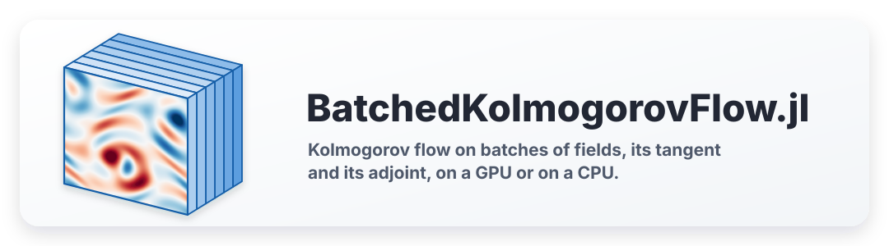
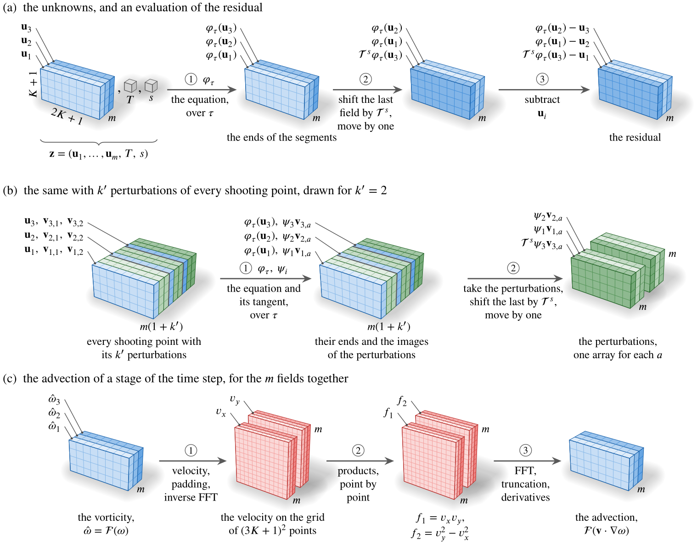
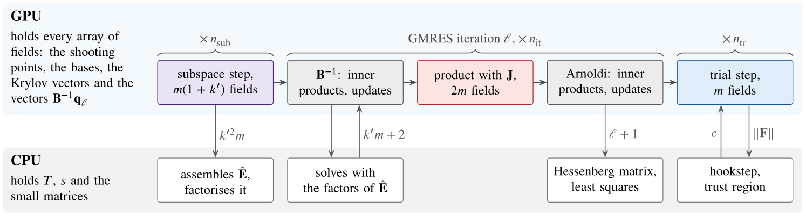

<p align="center">
  
</p>

# BatchedKolmogorovFlow.jl

Two-dimensional Kolmogorov flow on batches of vorticity fields, in Julia. The package gives the
vorticity equation, its tangent equation and the transpose of the tangent, with all the fields of
a batch advanced together, on a GPU, on one core of a CPU or on several. A batch may hold the
states of many flows, or the segments of one orbit with their perturbations: the objects of the
package are those that [MultipleShooting.jl](https://github.com/Davide-Lasagna-s-Lab/MultipleShooting.jl)
calls in its searches for periodic orbits.

The package has four parts, and this page follows them.

- **The state.** `FTFields`, a batch of fields in Fourier space, an array with the fields along
  its last dimension, with the inner product of the fields.
- **The dynamics.** Callable objects, each with one task and the workspaces of that task: the flow,
  the tangent of any number of perturbations, forced or not, the right-hand side, the shift, and
  the adjoint.
- **The devices.** The same code on a GPU and on a CPU, with the terms of the equation written
  entry by entry, three kernels on the GPU, or as broadcasts.
- **The searches.** The objects in the calls of MultipleShooting.jl, at a fixed Reynolds number or
  with the Reynolds number free.

The equation, its terms and their names are those of
[OpenKolmogorovFlow.jl](https://github.com/Davide-Lasagna-s-Lab/OpenKolmogorovFlow.jl) (OKF),
whose results the package gives field by field, to rounding. The time stepping is that of
[Flows.jl](https://github.com/Davide-Lasagna-s-Lab/Flows.jl), with constant steps: the IMEX
Runge–Kutta scheme `CB3R2R3e` by default, or `CNRK2`, `CB3R2R2`, `CB3R2R3c` or `CB4R3R4`, with the
viscous term implicit, or the exponential `ETDRK2` or `ETDRK4`, with the viscous term exact, by the
keyword `scheme`.

**Contents.**
[Installation](#installation) ·
[Examples of use](#examples-of-use) ·
[The state](#the-state) ·
[On a GPU and on a CPU](#on-a-gpu-and-on-a-cpu) ·
[Interface](#interface) ·
[The adjoint](#the-adjoint) ·
[With MultipleShooting](#with-multipleshooting) ·
[The files](#the-files) ·
[Tests and examples](#tests-and-examples) ·
[References](#references)

## Installation

The package and its dependencies OpenKolmogorovFlow.jl, Flows.jl, MultipleShooting.jl and
NKRoots.jl are not registered. Clone them side by side and develop them in the environment:

```
git clone https://github.com/Davide-Lasagna-s-Lab/Flows.jl
git clone https://github.com/Davide-Lasagna-s-Lab/OpenKolmogorovFlow.jl
git clone https://github.com/Davide-Lasagna-s-Lab/NKRoots.jl
git clone https://github.com/Davide-Lasagna-s-Lab/MultipleShooting.jl
git clone https://github.com/Davide-Lasagna-s-Lab/BatchedKolmogorovFlow.jl
julia -e 'using Pkg; Pkg.develop([PackageSpec(path=p) for p in ("Flows.jl", "OpenKolmogorovFlow.jl",
          "NKRoots.jl", "MultipleShooting.jl", "BatchedKolmogorovFlow.jl")])'
```

CUDA.jl is not a dependency. Load it, `using CUDA`, and `device=:gpu` puts the batches on the GPU.

## Examples of use

[`examples/usage.jl`](examples/usage.jl) runs the examples of this section, each with a check,
on the CPU, or on a GPU with `gpu` as its argument.

**A batch.** `B` fields in Fourier space, one array with the fields along its third dimension.
Here three smooth random ones: random coefficients that fall with the wavenumber, made fields by
`apply_symmetry!`.

```julia
using BatchedKolmogorovFlow, LinearAlgebra, Random

n, m, Re, kf = 21, 31, 40.0, 4      # modes, grid of 2m + 2 = 64 points, Reynolds number, forcing
B            = 3

X  = randn!(FTFields(n, B))         # an array (n+1, 2n+1, B)
X .= X ./ (1 .+ X.j.^2 .+ X.k.^2)   # X.j and X.k are the wavenumbers, and broadcast against X
BatchedKolmogorovFlow.apply_symmetry!(X)

dots(X, X)                          # the inner product of each field with itself, (1, 1, B)
dot(X, X)                           # their sum
view(X, :, :, 1:2)                  # the first two fields, a batch that shares them
```

**The flow.** An object made once for batches of `B` fields, with its workspaces, which advances
them together, in place.

```julia
G = NonlinearPropagator(n, m, Re, kf; B=B)
Y = G(copy(X), 1.0)                 # every field advanced by one time unit
```

**The tangent.** The fields and their perturbations advanced together, the perturbations by the
tangent equation: the derivative of the discrete flow. With `k′` perturbations of every field, a
vector of `k′` batches, the fields are advanced once for all of them.

```julia
L  = TangentPropagator(n, m, Re, kf; B=B)
LV = L(copy(X), copy(V), 1.0)       # V a batch like X, one perturbation of every field

L₃ = TangentPropagator(n, m, Re, kf; B=B, k′=3)
L₃(copy(X), Vs, 1.0)                # Vs a vector of three batches like X, advanced in place
```

**The Reynolds number.** The tangent forced by the derivative of the equation in the Reynolds
number gives, from zero, the derivative of the flow in it. Every object has a second form, the
object at another Reynolds number, which shares its workspaces.

```julia
Lp = TangentPropagator(n, m, Re, kf; B=B, forced=true)
dR = Lp(copy(X), fill!(similar(X), 0), 1.0)     # dG/dRe at X

G⁺ = NonlinearPropagator(G, Re + 1e-3)          # the flow at another Reynolds number
```

**The right-hand side and the shift.** The time derivative of every field, and the shift along
`x`, the continuous symmetry of the flow, with its generator.

```julia
F  = RightHandSide(n, m, Re, kf; B=B)
S  = XShift()

F(dX, X)                            # dX = dω/dt at every field
S(X, 0.7)                           # ω(x, y) → ω(x + 0.7, y), in place
S(dX, X, 1)                         # dX = ∂ω/∂x, the generator of the shift
```

An orbit may close after a translation along `y` by whole wavelengths `2π/kf` of the forcing, a
discrete symmetry of the flow. Its shift translates too, by `sy` wavelengths fixed for the orbit,
so that the parts of a search that shift the end of the last segment translate it.

```julia
S  = XShift(; sy=2, kf=kf)
S(X, 0.7)                           # ω(x, y) → ω(x + 0.7, y + 2π sy/kf), in place
```

**The adjoint.** The transpose of the tangent, back over the stages of the flow, which are kept
once and serve any number of adjoint fields.

```julia
A  = AdjointPropagator(n, m, Re; B=B)
St = stages(G, X, 1.0)              # a forward pass from X, every stage kept
AW = A(copy(W), St)                 # a backward pass: dots(LV, W) == dots(V, AW), to rounding
```

**On a GPU, and on several cores.** The same calls, with the batches on the device.

```julia
using CUDA

G = NonlinearPropagator(n, m, Re, kf; B=B, device=:gpu)
X = FTFields(CuArray(parent(X)))    # the batch on the GPU
G(X, 1.0)

G = NonlinearPropagator(n, m, Re, kf; B=64, tasks=8)    # on the CPU, eight chunks of fields
```

The checks that the script prints:

```
the flow: G(X, 1) against G(G(X, 0.5), 0.5), 1.3e-16
the tangent: L(X, V, 1) against a centred difference of the flow, 1.6e-09
three perturbations at once: the second against the tangent of it alone, 0.0e+00
the forced tangent: against a centred difference in the Reynolds number, 7.6e-06
the right-hand side: F(dX, X) against (G(X, h) - X)/h, h = 1e-4, 2.0e-04
the generator of the shift: S(dX, X, 1) against a centred difference of S, 9.6e-10
the shift and the flow: G(S(X, 0.7), 1) against S(G(X, 1), 0.7), 1.1e-15
the adjoint: <L V, W> and <V, A W>, field by field,
    [0.08994001053742048, 0.2790507182738552, -0.05341832223669146]
    [0.08994001053742103, 0.27905071827385497, -0.05341832223669071]
```

The forced tangent takes its forcing as an explicit term of the scheme, so that it is the
derivative of the flow up to the error of the scheme, here `1e-5`.

## The state

A field is real and periodic on `[0, 2π)²`, with the Fourier coefficients

    ω(x, y) = Σⱼ Σₖ Ω[j, k] exp(i (j x + k y)),   j, k = -n, …, n.

Only the coefficients with `j ≥ 0` are kept, the others being their conjugates.
A batch of `B` fields is an `FTFields{n}`, an array `X` of size
`(n+1, 2n+1, B)`. Field `b` is `X[:, :, b]`, with `j = 0, …, n` along `x` down
the rows and `k` along `y` across the columns, in the order
`0, 1, …, n, -n, …, -1`. Two conditions make such a slice a field: in the row
`j = 0` the entries at `k` and `-k` are conjugates, and the mean is zero.
`apply_symmetry!` imposes them.

This is the `FTField{n, m}` of OKF without the modes that it keeps at zero, and
transposed. A batch is made by one of four constructors:

```julia
X = FTFields(data, n)         # wraps the coefficients data, (n+1, 2n+1, B)
X = FTFields(data)            # the same, with n from the size of data
X = FTFields(Ωs)              # from a vector of fields of OKF, on the CPU
X = FTFields(n, B; device=:cpu)   # B fields of zeros, on :cpu or :gpu
```

The first is the inner one: it keeps `data`, without copying, and builds from
`n`, on the device of `data`, the wavenumbers `X.j` (a column) and `X.k` (a
row), which broadcast against the batch, and the weights `X.w` (a column) of
the inner product. `parent(X)` returns the coefficients, and `FTField(X, b, m)`
gives field `b` back as a field of OKF. `view(X, :, :, r)` with a range `r` is
the batch of those fields, sharing the coefficients.

The inner product of two fields is the mean of `ω₁ ω₂`. The modes with
`j ≥ 1` stand for their conjugates too, and count twice, which `X.w` holds.
`dots(X, Y)` gives it field by field, a real array `(1, 1, B)`, and
`LinearAlgebra.dot(X, Y)` is its sum over the fields. Both are real and
weighted. `dots` is the method of `MultipleShooting.dots` for a batch, and
`MultipleShooting.states(X, r)` is `view(X, :, :, r)`, so that the first and
the last states of the seeds, which a search takes, are batches and keep this
product.

On the grid a batch is a `Fields{m}`, a real array `(2m+2, 2m+2, B)` with `x`
down the rows and `y` across the columns, the `Field{m}` of OKF transposed.



*The arrays, from Lasagna et al. (2026), drawn for three fields. There `K` is the largest
wavenumber, `n` here, and `m` the number of segments of an orbit, the fields `B` of a batch. (a) A
batch, the seeds of a search, and an evaluation of its residual by the flow. (b) The bundle of the
tangent, every field followed by its `k′` perturbations, advanced as one batch. (c) A stage of
the time step, the three passes of the terms, with the arrays on the grid in red.*

## On a GPU and on a CPU

The code is generic over the array of a batch. Every operation acts on all the fields of the
batch. The keywords `device` and `tasks` of the propagators say where a batch runs.

| keywords | where a batch runs |
|---|---|
| `device=:gpu` | On the GPU, on `CuArray`s, which works on all the fields at once. cuFFT does the transforms. CUDA is loaded by the user, `using CUDA`, and is not a dependency of the package: an extension of the package gives the arrays of the GPU once it is loaded. |
| `device=:cpu` | On one core of the CPU, on `Array`s. FFTW does the transforms. An operation on an array runs on one core, so that a batch, however large, uses one core. |
| `device=:cpu, tasks=N` | On `N` cores of the CPU. The batch is cut into `N` chunks of fields, and `N` tasks advance one chunk each, at the same time, each as a batch of its own on its own thread. |

A batch of 10 fields with `tasks=4` is cut into the fields `1:2`, `3:5`, `6:7` and `8:10`. The
fields of a batch do not act on one another, since a field with its perturbations is one segment
of an orbit. The chunks are then separate integrations, and the result is that of one task, to
rounding. The tasks run at the same time and cannot share arrays or plans, so that each has its
own workspace. The flow and the tangent, forced or not, use the tasks. The other functions run on
one. Start Julia with at least `N` threads, `julia -t N`.

### The terms entry by entry

The advection is written in the form of Basdevant (1983),
`(∂²/∂x² - ∂²/∂y²)(u v) + ∂²/∂x∂y (v² - u²)`, which needs the velocity alone on the grid: two
transforms to the grid and two back, each pair made as one transform of a batch of twice the
fields. The grid has `2m+2` points along each direction, at least `3n + 1`, so that the products
have no aliasing on the modes kept.

Between its two transforms a term is three passes over its arrays (`src/kernels.jl`):

| pass | from | to |
|---|---|---|
| the velocity | the fields | their velocity among the wavenumbers of the grid, with its zeros |
| the products | the velocity on the grid | `u v` and `v² - u²`, and for a perturbation `u v′ + u′ v` and `2 (v v′ - u u′)` |
| the advection | the transforms of the products | the term, with the symmetry of fields and the forcings |

Each pass computes every entry of the array it writes from the indices of the entry, the
wavenumbers among them, so that it reads no array of wavenumbers and makes no temporary. The
explicit term is the term of a bundle with no perturbation, and the same three passes serve the
flow, the tangent of any number of perturbations and the forced tangent. On the CPU a pass is a
loop. On the GPU it is a kernel (`ext/kernels.jl`), and this is what the passes are for: a kernel
costs its launch whatever it computes, and written as broadcasts the two terms launch 13 and 17.

`kernels=true` is the default. `kernels=false` gives the broadcasts, the same to rounding, which
the tests keep as the reference. On the CPU the two take the same time.

## Interface

```julia
using BatchedKolmogorovFlow

G  = NonlinearPropagator(n, m, Re, kf; B, dt=0.01, scheme=:CB3R2R3e,
                         device=:cpu, tasks=1, kernels=true)
L  = TangentPropagator(n, m, Re, kf; B, k′=1, forced=false, dt=0.01,
                       scheme=:CB3R2R3e, device=:cpu, tasks=1, kernels=true)
F  = RightHandSide(n, m, Re, kf; B, device=:cpu, kernels=true)
S  = XShift(; sy=0, kf=0)
A  = AdjointPropagator(n, m, Re; B, scheme=:CB3R2R3e, device=:cpu)
```

`scheme` is a key of `Flows.imex_schemes`: `:CNRK2`, `:CB3R2R2`, `:CB3R2R3e`,
`:CB3R2R3c` or `:CB4R3R4`, or the exponential `:ETDRK2` or `:ETDRK4`, all with
their stages and their discrete adjoint. `device`, `tasks` and `kernels` are
those of the section above. `B` has no default, and `kf` is in `1:n`. `sy`, the
translation along `y` of the shift in wavelengths of the forcing, needs `kf` of
the propagators when it is not zero.

Each object has one task, which it does when called, on batches of `B` fields,
and holds the workspaces of that task, made with it, so that a call allocates
no batch, but for the stages that `stages` returns. A call with another number
of fields is an error. Each takes a second form, `NonlinearPropagator(G, Re₂)`, `TangentPropagator(L,
Re₂)`, `RightHandSide(F, Re₂)`, `AdjointPropagator(A, Re₂)`, the object at
another Reynolds number, which shares its workspaces and its Flows.jl flow,
rebuilt there around the same terms and registers, and costs nothing. Two that
share must not run at the same time. `XShift(S, Re₂)` returns `S`, which does
not depend on the Reynolds number.

| call | what it does |
|---|---|
| `G(X, τ)` | advances every field of `X` in place by `τ`, in steps of `dt` and a last shorter step that ends on `τ` |
| `L(X, V, τ)` | advances the fields `X` and the perturbations `V` together, `V` by the tangent equation, with the same scheme and steps: the derivative of the discrete flow. `V` is a batch like `X` when `k′ = 1`, or a vector of `k′` such batches, each about the fields of `X`, which are advanced once for all of them. With `forced = true` the tangent equation is forced by the derivative of the right-hand side in the Reynolds number, `-Δω/Re²` |
| `F(dX, X)` | the time derivative of every field |
| `S(X, s)` | `ω(x, y) → ω(x + s, y + 2π sy/kf)` for every field, the coefficients times `cis(j s + 2π k sy/kf)`; any number of fields |
| `S(dX, X, 1)` | the generator of the shift, `∂ω/∂x` |
| `stages(G, X, τ)` | the stages of every step of the flow over `τ` from the fields `X`, which are left as they are, kept for the adjoint |
| `A(W, S)` | the transpose of the tangent applied to `W`, back over the stages `S` |
| `dots(X, Y)` | the inner products of the fields one by one, the mean of `ω₁ ω₂`, a real array `(1, 1, B)`: the method of `dots` of MultipleShooting |
| `dot(X, Y)` | their sum over the fields, a method of `LinearAlgebra.dot` |

Every call takes views of a batch, `view(X, :, :, r)` with a range `r`. The
flow, the tangent, the right-hand side, `stages` and the adjoint first give
their input the symmetry of fields, by `apply_symmetry!`, so that the flow, its
tangent and its adjoint vanish on what is not a field. The shift does not.

Field by field the flow, the tangent, the adjoint and the right-hand side give
the results of OKF with Flows to rounding. The forced tangent treats its
forcing as an explicit term, so that it gives the derivative of the flow in the
Reynolds number up to the error of the scheme.

## The adjoint

The adjoint is the transpose of the derivative of the discrete flow in the
inner product of the fields, `dots`. For any batches `V` and `W`, field by
field and to rounding,

    dots(L(copy(X), V, τ), W) == dots(V, A(W, stages(G, X, τ)))

It is the adjoint of the scheme in Flows, with the explicit term `AdjointTerm`,
stepped backwards over the stages of the steps of the flow.
`AdjointTerm` is `TangentTerm` read backwards, each step replaced by its
transpose, the forward transform by the inverse one and the inverse by the
forward one. It equals the adjoint of the linearised advection,

    u ∂μ/∂x + v ∂μ/∂y + Δ⁻¹(∂μ/∂x ∂ω/∂y - ∂μ/∂y ∂ω/∂x),

the `LinearisedExTerm` of OKF in its adjoint mode, to rounding.

The adjoint needs the stages from the last step back, so that they are made
first, once, and kept:

```julia
S = stages(G, X, τ)       # a forward pass from the fields X, every stage kept
A(W, S)                   # a backward pass over them, for this W
A(W₂, S)                  # and for any other, with no new forward pass
```

`S` holds the stages of each of the `N` steps over `τ`, four with the default
scheme, `4N` batches like `X`. For one field with `n = 33` and steps of 0.01
this is 14.6 GB over
1000 time units, whatever the number of segments the orbit is cut into, and
146 GB over 10⁴. `W` has as many fields as the batch that made `S`. For
several adjoint fields about each field of `X`, call the adjoint once for each,
over the same `S`.

## With MultipleShooting

MultipleShooting.jl takes a callable for each part of a search: `Residual(G;
S)`, `Jacobian(L, F, z; S, dS, dG)`, `Subspace(L, z; k′, S)`,
`Preconditioner(L, F, z; k′, S, dS)`, `tangent_sensitivity(L, Lp, F, z; S, dS,
dG)`, and `freesearch!` and `continuation!`. A relative periodic orbit has the
shift `S` and its generator `dS`, both the `XShift()` of this package, or
`XShift(; sy, kf)` for an orbit that closes after a translation along `y`. The
search below leaves the Reynolds number free, from the seeds `X`, a batch of
`ns` fields, one per segment, the period `T` and the shift `s`.

```julia
using MultipleShooting

z  = ShootingVector(X, [T, s])
G  = NonlinearPropagator(n, m, Re, kf; B=ns)
L  = TangentPropagator(n, m, Re, kf; B=ns)                  # k′ = 1
Lk = TangentPropagator(n, m, Re, kf; B=ns, k′=k′)           # the preconditioner
Lp = TangentPropagator(n, m, Re, kf; B=ns, forced=true)     # d/dRe
F  = RightHandSide(n, m, Re, kf; B=ns)
S  = XShift()

M = Preconditioner(Lk, F, z; k′=k′, S=S, dS=S)

# each object at the Reynolds number Re, by its second form
family(x::NonlinearPropagator, Re) = NonlinearPropagator(x, Re)
family(x::TangentPropagator,   Re) = TangentPropagator(x, Re)
family(x::RightHandSide,       Re) = RightHandSide(x, Re)
family(x::XShift,              Re) = XShift(x, Re)

out = freesearch!(family, G, L, F, z, Re; Lp=Lp, S=S, dS=S, precond=M)
```

`family(x, Re)` moves each object, and those of the preconditioner, to the
Reynolds number, sharing their workspaces. `L` is the tangent of one
perturbation of every field, for the Jacobian, `Lk` that of `k′`, which the
subspace iteration and the preconditioner call, and `Lp` the tangent forced by
`-Δω/Re²`, which gives the column of the Reynolds number. At a fixed Reynolds
number the search is made of `Residual(G; S=S)` and `Jacobian(L, F, z; S=S,
dS=S)`, with `M` as preconditioner. The inner product of the fields is `dots`
above, so that the Krylov method, the phase conditions and the preconditioner
all use it. The segments have equal lengths.



*A Newton step of a search on the two devices, from Lasagna et al. (2026). The GPU holds every
array of fields and does every operation on them; the CPU holds the period, the shift and the small
matrices, and only numbers cross between the two.*

## The files

| file | what it holds |
|---|---|
| `ftfields.jl` | `FTFields`, a batch in Fourier space, with its wavenumbers and weights, `apply_symmetry!`, `dots` and `dot`, the methods of MultipleShooting on a batch, the passage from and to OKF |
| `fields.jl` | `Fields`, a batch on the grid |
| `operators.jl` | `ddx!`, `ddy!`, `laplacian!`, `invlaplacian!` on batches |
| `fft.jl` | `InverseFFT!` and `ForwardFFT!`, between the two |
| `implicit.jl` | `ImplicitTerm`, the viscous term, implicit, or exact by the coefficients of the exponential schemes |
| `nonlinear.jl` | `ExplicitTerm`, advection and forcing |
| `linearised.jl` | `TangentTerm`, the linearised advection, `ForcedTangentTerm`, and `AdjointTerm`, its transpose |
| `dynamics/nonlinearpropagator.jl` | `NonlinearPropagator`, the flow, and `stages` |
| `dynamics/tangentpropagator.jl` | `TangentPropagator`, the flow with its tangent, forced or not |
| `dynamics/righthandside.jl` | `RightHandSide`, the time derivative of the fields |
| `dynamics/xshift.jl` | `XShift`, the shift along `x` and its generator |
| `dynamics/adjointpropagator.jl` | `AdjointPropagator`, the transpose of the tangent, back over the stages |
| `dynamics/checks.jl`, `chunks.jl`, `flows.jl` | what they share: the checks of their arguments, the chunks of the tasks on the CPU, the flows of Flows.jl at another Reynolds number |
| `BatchedKolmogorovFlow.jl` | the module, its exports and the order of the includes |
| `kernels.jl` | the terms entry by entry, in three passes: what an entry is, and the loops of the CPU |
| `ext/BatchedKolmogorovFlowCUDAExt.jl`, `ext/kernels.jl` | the extension that gives the arrays of the GPU, `CuArray`, once `using CUDA`, and the three kernels of the terms |

## Tests and examples

```
julia --project=test test/runtests.jl
DEVICE=gpu julia --project=test test/runtests.jl
julia --project=examples examples/usage.jl
```

The tests compare every function with OKF and Flows on a small grid (`n = 8`,
`m = 12`), field by field, for several batch sizes and on views. They check
the tangent against a centred difference of the flow, with its error falling
as the square of the increment, the right-hand side against a short step of the
flow, the forced tangent against a centred difference in the Reynolds number,
and the adjoint and `AdjointTerm` against the tangent and `TangentTerm` by the
identity of the transpose. They check that the flow commutes with the shift
along `x`, the rotation by π and the shift-reflect, that the advection keeps
the energy and the enstrophy, that a call allocates much less than a batch,
and the methods of MultipleShooting on a product with its Jacobian. The files
of `test/` hold them by topic.

With `DEVICE=gpu` the batches are `CuArray`s. CUDA is a dependency neither of
the package nor of the test environment: it is loaded from another environment
of the load path, the global one by default.

`examples/usage.jl` holds the examples of use above, with their checks.
`examples/orbits.jl` reads the orbits and the seeds of the campaigns into
batches of seeds. A state that must fill several segments is advanced by whole
steps of `dt`, and each shooting point takes the rest of a step on a copy. A
shorter step that the integration went on from would leave the trajectory of
the simulation about `1e-9` off, and the recurrence would be lost by
`T ≈ 150`. An orbit that closes after a translation along `y` comes with its
`sy`, for `XShift(; sy, kf)`.

## References

- C. Basdevant, *Technical improvements for direct numerical simulation of homogeneous
  three-dimensional turbulence*, J. Comput. Phys. **50**, 209–214 (1983). The form of the
  advection.
- G. J. Chandler and R. R. Kerswell, *Invariant recurrent solutions embedded in a turbulent
  two-dimensional Kolmogorov flow*, J. Fluid Mech. **722**, 554–595 (2013). Kolmogorov flow and
  its recurrent solutions.
- D. Lasagna, O. Ashtari, T. Burton and T. M. Schneider, *Multiple shooting search of long unstable
  periodic orbits in turbulent flows*, in preparation (2026). The searches that the package serves.
